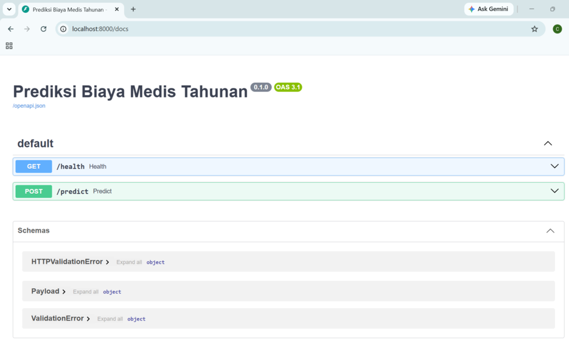
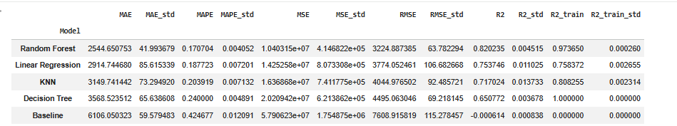
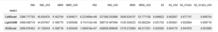
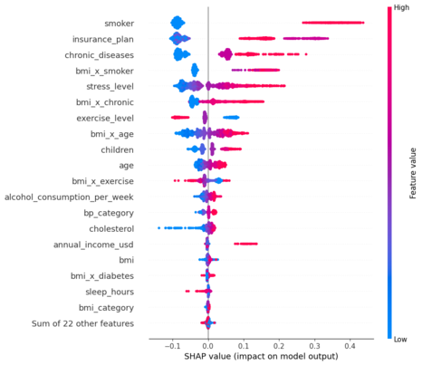
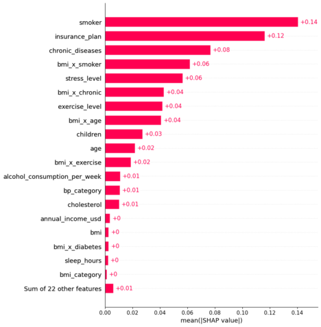
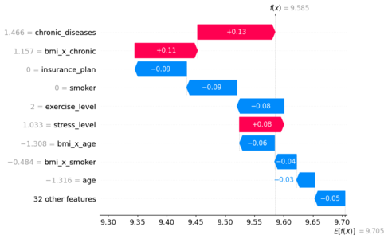
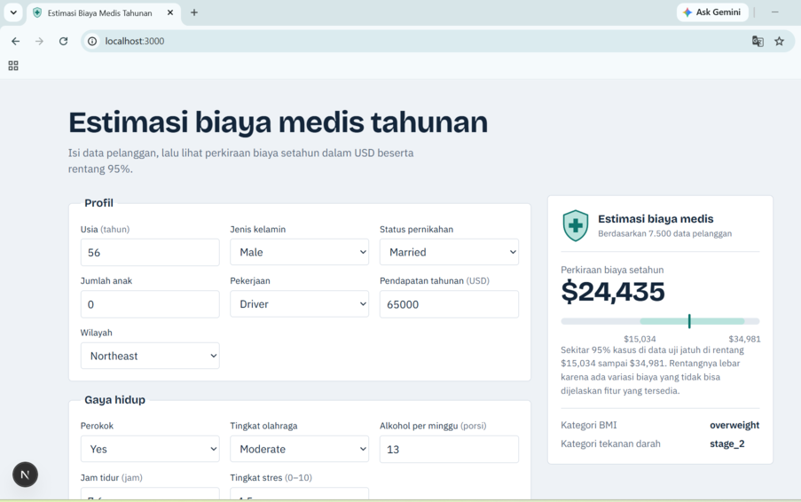
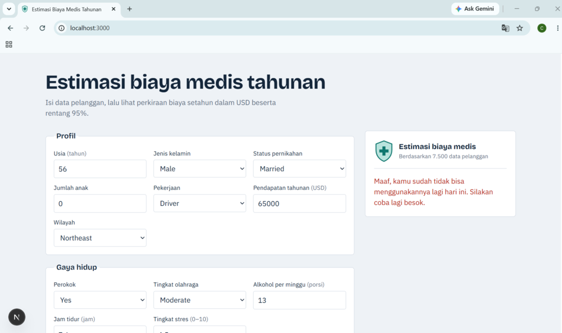

# Estimasi Biaya Medis Tahunan

Model regresi untuk memperkirakan **biaya medis tahunan (USD)** dari profil demografi, gaya hidup, kondisi kesehatan, dan plan asuransi, lengkap dengan rentang estimasi 95%. Backend memakai **FastAPI**, frontend memakai **Next.js**.

> Angka ini adalah perkiraan biaya medis, bukan premi atau harga polis asuransi.

## Tampilan aplikasi

Aplikasi dijalankan lokal (frontend di `localhost:3000`, backend di `localhost:8000`).



## Data

Dataset `medical_insurance_cost_dataset_enhanced.csv`: 7.500 baris dan 22 kolom asli. Target: `annual_medical_cost_usd`. Data dibagi 80% latih dan 20% uji dengan `random_state=42`.

## Notebook

Proses modelling lengkap ada di [notebooks/insurance_enhanced.ipynb](notebooks/insurance_enhanced.ipynb). Notebook dijalankan di Google Colab dengan data di Google Drive, jadi path seperti `/content/drive/MyDrive/...` perlu disesuaikan kalau dijalankan di tempat lain.

## Perbandingan model (5-fold CV)

Model dasar (non-boosting):



Model boosting:



[CatBoost memberi RMSE terendah (sekitar ...) dan R² sekitar ... pada CV.]

## Tuning dan evaluasi

Parameter terbaik hasil RandomizedSearchCV (30 iterasi): `learning_rate=0.03`, `l2_leaf_reg=5`, `iterations=500`, `depth=4`. RMSE pada CV sekitar 3.030. Skor di test set: MAE sekitar $2.331, RMSE sekitar $2.942, R² sekitar 0,843.

## Interpretasi (SHAP)





Nilai SHAP ada di skala log1p (target dilatih sebagai `log1p(biaya)`), jadi +0.1 kira-kira berarti biaya naik sekitar 10%. Pengaruh BMI tersebar di beberapa fitur turunan (`bmi`, `bmi_x_*`, `bmi_category`).

## Struktur proyek

```
insurance-app/
├── backend/     FastAPI, model_final.joblib, metadata.json
├── frontend/    Next.js (App Router)
├── notebooks/   notebook modelling (Google Colab)
└── docs/        screenshot
```

## Menjalankan

### 1. Backend

```bash
cd backend
python -m venv .venv
.venv\Scripts\activate            # Mac/Linux: source .venv/bin/activate
pip install -r requirements.txt
uvicorn main:app --reload --port 8000
```

Dokumentasi API otomatis: http://localhost:8000/docs

`scikit-learn` dipin ke 1.6.1 dan `catboost` ke 1.2.10, sesuai versi yang dipakai saat model disimpan. Versi lain bisa gagal memuat model. Python 3.12 sudah teruji.



### 2. Frontend

```bash
cd frontend
copy .env.local.example .env.local     # Mac/Linux: cp
npm install
npm run dev
```

Buka http://localhost:3000. Kalau backend tidak di port 8000, ubah `NEXT_PUBLIC_API_URL` di `.env.local`.

## Contoh request

```bash
curl -X POST http://localhost:8000/predict -H "Content-Type: application/json" -d '{
  "age":56,"gender":"Male","bmi":25.2,"children":2,"smoker":"Yes","region":"Northeast",
  "occupation":"Driver","annual_income_usd":77885,"exercise_level":"Moderate",
  "chronic_diseases":0,"alcohol_consumption_per_week":13,"insurance_plan":"Basic",
  "diabetes":"Yes","cholesterol":224,"sleep_hours":7.6,"stress_level":4.5,
  "marital_status":"Married","blood_pressure_systolic":150,"blood_pressure_diastolic":95}'
```

## Batas pemakaian

`/predict` dibatasi **10 request per menit** dan **20 prediksi per hari per alamat IP** (reset tengah malam WIB). Hitungannya disimpan di memori server, jadi hilang saat server restart. Pesan untuk batas menit dan batas harian dibedakan.



Cara menguji: jalankan backend, lalu `python test_limit.py` di folder `backend` (butuh sekitar satu menit).

## Konfigurasi (environment variable backend)

| Variabel          | Fungsi                                                                               |
| ----------------- | ------------------------------------------------------------------------------------ |
| `ENV=production`  | Mematikan halaman `/docs`, `/redoc`, dan `/openapi.json`                             |
| `ALLOWED_ORIGINS` | Domain frontend yang diizinkan CORS, dipisah koma. `localhost:3000` selalu diizinkan |

## Asumsi dan keterbatasan

- `doctor_visits_per_year` dan `hospitalizations_last_year` dibuang karena diasumsikan tercatat setelah layanan dipakai (leakage terhadap target).
- `insurance_plan` diasumsikan sudah ditentukan sebelum prediksi dibutuhkan. Urutan Basic < Standard < Gold < Premium berdasarkan konvensi penamaan, bukan dokumentasi dataset, dan rata-rata biaya di data tidak monoton (Gold > Premium).
- Rentang 95% diambil dari persentil rasio biaya aktual terhadap prediksi di data uji, dan mengasumsikan error proporsional di semua level biaya.
- Model menangkap asosiasi di data ini, bukan hubungan sebab-akibat. Bukan nasihat medis.

## Catatan deploy

Proyek ini dijalankan lokal dan belum di-deploy.
